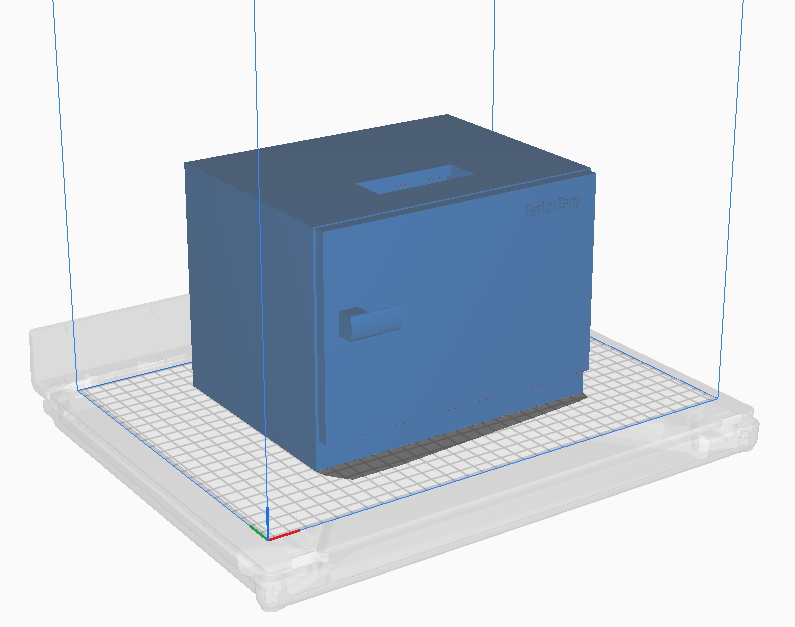
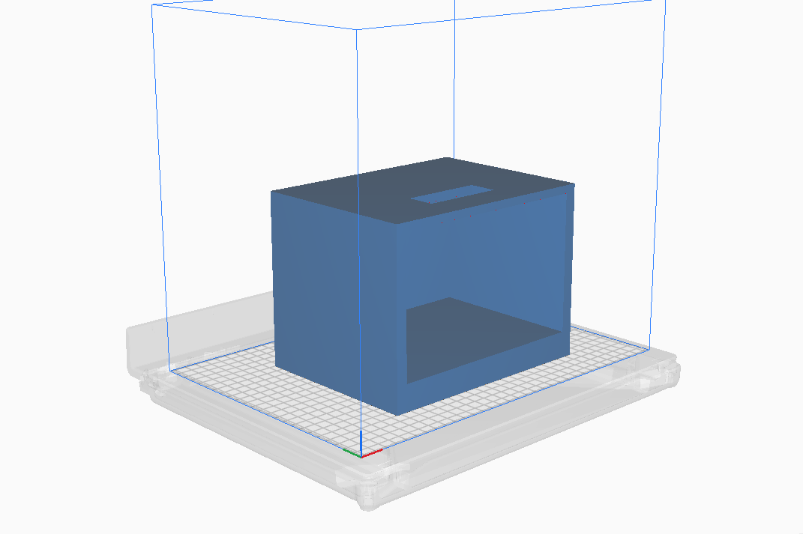
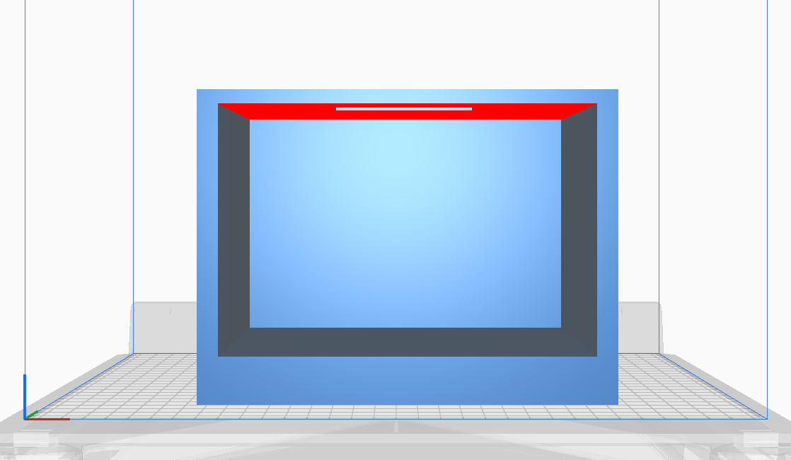
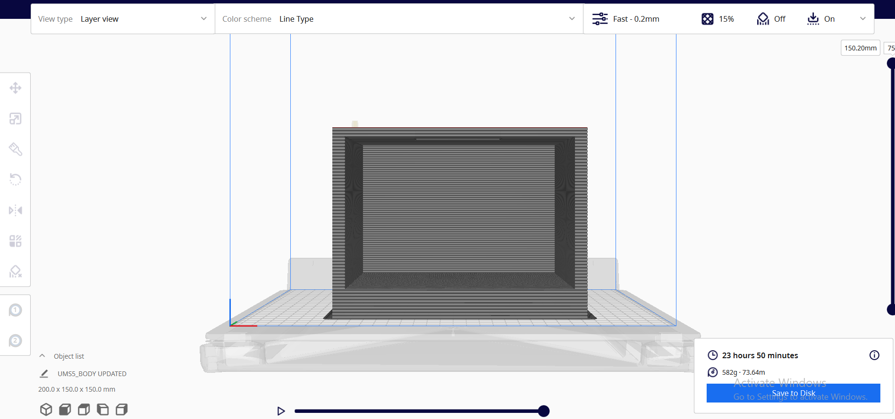

# ESP32 Smart Refrigerator System

An embedded smart refrigerator prototype developed using the ESP32 microcontroller, integrating environmental monitoring, thermoelectric cooling, door-state detection, and dual power operation.

## Technical Documentation

- [Hardware Components](hardware/components.md)
- [System Architecture](docs/system-architecture.md)
- [Hardware Documentation](docs/hardware-documentation.md)
- [Power System](docs/power-system.md)
- [Software Documentation](docs/software-documentation.md)
- [Testing and Validation](docs/testing-and-validation.md)

  
## 3D Design and Modeling

The refrigerator enclosure was developed as a 3D model, with separate body and door components and a fully assembled representation.

### Refrigerator Design

### Individual Components

| Refrigerator Body | Refrigerator Front |
|---|---|
|  |  |

### 3D Printing Preparation

### Download 3D Files

- [Refrigerator Body (STL)](hardware/3d-models/refrigerator-body.stl)
- [Refrigerator Door (STL)](hardware/3d-models/refrigerator-door.stl)
- [Fully Assembled Model (STL)](hardware/3d-models/refrigerator-fully-assembled.stl)

## 1. Project Overview

The Smart Refrigerator System is a physically implemented and operational refrigerator prototype developed as part of the LankonFarm startup project.

The system combines embedded electronics, temperature and humidity monitoring, thermal management, power conversion, and mechanical design to provide an integrated refrigeration solution.

The prototype was presented at the 13th session of the World Urban Forum (WUF13), where the project was represented by its embedded systems engineering team.

## 2. Key Features

- **Environmental Monitoring:** Measures temperature and humidity inside the refrigerator.
- **LCD Interface:** Displays environmental measurements to the user.
- **Door-State Detection:** Uses a magnetic sensor to detect whether the refrigerator door is open or closed.
- **Door-Open Alert:** Activates a buzzer when the door remains open beyond a configurable time threshold.
- **Thermoelectric Cooling:** Uses a Peltier module for cooling.
- **Thermal Management:** Incorporates separate internal and external radiator assemblies for cold-side and hot-side thermal management.
- **Air Circulation:** Uses an internal computer fan to distribute cooled air throughout the refrigerator.
- **Dual Power Operation:** Supports AC and battery power, with manual selection between the two power sources.
- **Mechanical Door Design:** Incorporates a hinge mechanism and magnetic door-closing mechanism.

## 3. Hardware Components

| Component | Function |
|---|---|
| ESP32 | Main embedded controller |
| Temperature and humidity sensor | Environmental monitoring |
| LCD | Measurement display |
| Magnetic sensor | Door-state detection |
| Buzzer | Door-open warning |
| Peltier module | Thermoelectric cooling |
| External radiator | Hot-side heat dissipation |
| Internal radiator | Cold-side thermal interface |
| Computer fan | Internal air circulation |
| SMPS (220V AC to 12V DC) | AC power conversion |
| Battery | Alternative power source |

*Exact component models and electrical ratings will be documented when available.*

## 4. System Architecture

The system consists of four main functional subsystems:

1. **Embedded Control:** The ESP32 manages sensor readings, display updates, and door-alert logic.
2. **Cooling System:** The Peltier module provides thermoelectric cooling, supported by separate thermal management assemblies and internal air circulation.
3. **Power System:** A 220V AC to 12V DC SMPS provides the AC-powered supply, while a battery provides an alternative source selected manually.
4. **Door Monitoring:** A magnetic sensor detects door status, and a buzzer provides an alert when the door remains open beyond the configured threshold.

## 5. Door Monitoring and Alert Mechanism

The magnetic sensor monitors the refrigerator door state.

When the door remains open beyond the configured time threshold, the ESP32 activates the buzzer.

The warning delay is adjustable, with a 20-second setting used in the project.

## 6. Cooling and Thermal Management

The refrigeration system uses a Peltier thermoelectric module.

Two separate radiator assemblies are incorporated:

- An external, larger radiator for dissipating heat.
- An internal, smaller radiator associated with cooling the refrigerator interior.

An additional computer fan circulates air inside the refrigerator to improve the distribution of cooled air.

## 7. Power Supply Architecture

The refrigerator supports two manually selectable power sources:

- **AC operation:** 220V AC converted to 12V DC through an SMPS.
- **Battery operation:** An alternative battery-powered operating mode.

The power-source selection is manual rather than automatic.

Detailed circuit connections, battery specifications, and power-management information will be documented separately.

## 8. Project Resources

The repository includes the following engineering materials:

- ESP32 source code.
- Electronic schematic design.
- STL-format 3D model.
- 3D model visualization and rendered views.
- Hardware and software documentation.

## 9. Project Presentation

**World Urban Forum — 13th Session (WUF13)**

The Smart Refrigerator System was presented at WUF13 as part of the LankonFarm startup project.

**Project role:** Embedded Systems Engineer, LankonFarm.

Demonstration video: [Smart Refrigerator Prototype](https://youtube.com/shorts/mvteYwvX5kU)

## 10. Testing and Validation

The refrigerator was physically assembled and demonstrated as an operational prototype.

Historical implementation and demonstration evidence is included where available.

Detailed quantitative test measurements and independently reproducible validation results are not currently available in this repository.

The author does not currently have physical access to the prototype.

## 11. Limitations and Future Improvements

Potential areas for further development include:

- Detailed power consumption analysis.
- Temperature regulation and cooling-performance evaluation.
- Battery operating-time measurements.
- Improved thermal management.
- Additional monitoring and control functionality.
- More comprehensive system validation.

These are proposed improvements, not claims of already implemented functionality.

## 12. License

License information will be added after confirming the project's ownership and publication permissions.
